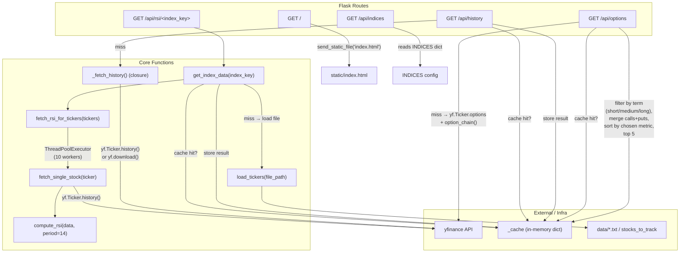
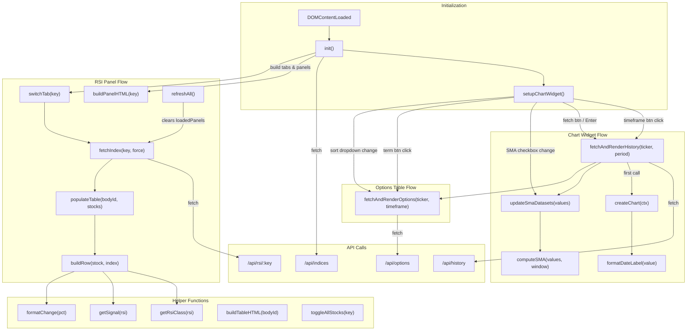
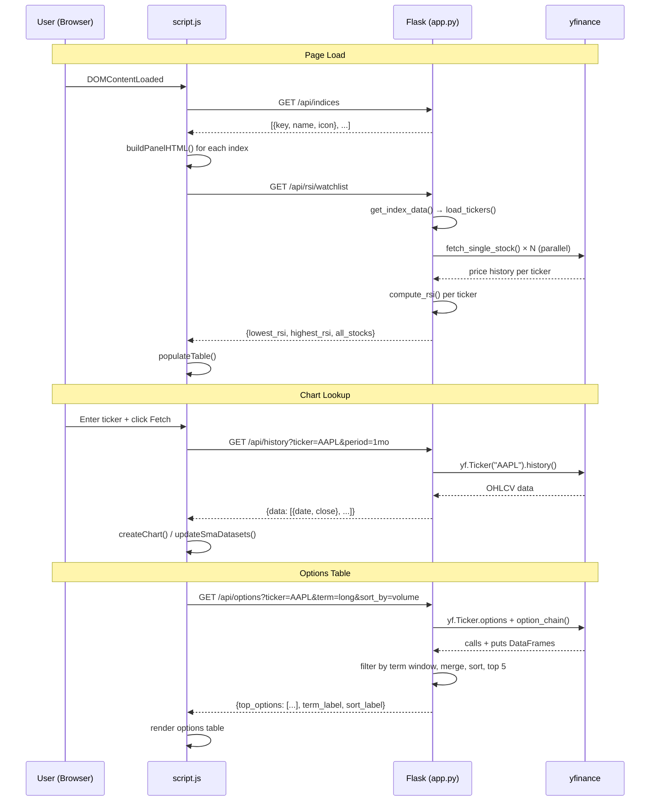

# Stocks RSI Dashboard

A lightweight Flask dashboard that calculates RSI across multiple indices/watchlists and provides a charting widget for a single ticker with SMA overlays plus a most‑traded options table.

## What this app does

- **RSI dashboard**: Top 5 lowest/highest RSI for each index/watchlist.
- **Ticker chart widget**: Search a ticker, choose a timeframe, and view a Robinhood‑style line chart.
- **SMA overlays**: Toggle SMA 50/100/200 on the chart.
- **Options table**: Top 5 options (calls + puts) with **Short / Medium / Long Term** expiry selector and configurable sort metric.

## High‑level architecture

- **Backend**: Flask (`app.py`)
  - Fetches market data via **yfinance** per‑ticker to avoid bulk download failures.
  - Computes RSI using **Wilder's smoothing** (exponential moving average, α = 1/14) — the same method used by Robinhood, TradingView, and most professional charting platforms.
  - Fetches 1 year of daily data per ticker for proper EMA warm‑up.
  - Drops NaN close prices before JSON serialization to prevent invalid JSON.
  - Caches expensive responses for 5 minutes.
- **Frontend**: Static HTML/CSS/JS in `static/`
  - Uses fetch() to load data from `/api/*` endpoints.
  - Uses **Chart.js** for the line chart.

### Data flow (RSI)
1. Browser calls `/api/indices`.
2. User selects a tab → browser calls `/api/rsi/<index_key>`.
3. Backend loads tickers from `data/*.txt` or `static/stocks_to_track`, fetches history per ticker, computes RSI, returns sorted results.

### Data flow (Chart)
1. User enters a ticker and timeframe.
2. Browser calls `/api/history?ticker=...&period=...`.
3. Backend returns close prices, frontend renders a line chart.
4. SMA toggles compute averages in the browser (no extra API call).

### Data flow (Options)
1. User selects an expiry term: **Short Term** (all), **Medium Term** (3–6 months), or **Long Term** (6 months – 2 years).
2. User optionally selects a sort metric: Volume, Open Interest, Expiry, Implied Volatility, or Tightest Spread.
3. Browser calls `/api/options?ticker=...&term=...&sort_by=...`.
4. Backend gathers option chains for matching expiries, merges calls+puts, returns top 5 by the chosen metric.

## Project structure

```
Stocks Dashboard/
├─ app.py                  # Flask API + RSI/options logic
├─ requirements.txt        # Python dependencies
├─ data/                   # Index ticker lists
├─ static/
│  ├─ index.html            # UI
│  ├─ style.css             # Styling
│  ├─ script.js             # Frontend logic
│  └─ stocks_to_track       # User watchlist
└─ README.md
```

## API endpoints

- `GET /api/indices` → list of index tabs
- `GET /api/rsi/<index_key>` → RSI results for an index
- `GET /api/history?ticker=TSLA&period=1mo` → chart data (NaN‑safe)
- `GET /api/options?ticker=TSLA&term=long&sort_by=volume` → top 5 options (calls + puts)

### Options `term` parameter
| Term | Expiry Window | Description |
|------|--------------|-------------|
| `short` | 0 – ∞ (all) | All available expirations, no filter |
| `medium` | 90 – 180 days | 3–6 months out |
| `long` (default) | 180 – 730 days | 6 months – 2 years out |

### Options `sort_by` parameter
| Value | Description |
|-------|-------------|
| `volume` (default) | Highest trading volume |
| `open_interest` | Highest open interest |
| `expiry` | Nearest expiry first |
| `iv` | Highest implied volatility |
| `spread` | Tightest bid‑ask spread |

The response includes: option type (Call/Put), expiry, strike, last price, bid, ask, volume, open interest, IV %, and spread.

## Local setup

### Requirements
- Python 3.10+

### Install
```
pip install -r requirements.txt
```

### Run
```
python app.py
```
Open http://127.0.0.1:5050 in your browser.

## Notes & tradeoffs

- **RSI method**: Uses Wilder's smoothing (EMA with α = 1/14), matching Robinhood and TradingView. Earlier versions used a simple moving average which gave significantly different (and incorrect) RSI values.
- **Data period**: Fetches 1 year of daily history per ticker to give the EMA enough warm‑up. This makes RSI fetches slightly slower than the old 1‑month fetch, but accuracy is dramatically improved.
- Yahoo Finance can return NaN for some trading days. The history API drops these rows before JSON serialization.
- Yahoo Finance can return empty data for delisted or restricted tickers. Those are skipped.
- Options volume from Yahoo is a **current snapshot**, not historical week‑by‑week volume.
- The term‑based expiry filter lets you focus on short, medium, or long‑dated options depending on your strategy.

## Customization

- Edit `static/stocks_to_track` to change your watchlist.
- Replace or expand ticker lists in `data/`.

---

## Changelog

### v1.1.0 (March 2026)
- **RSI accuracy fix**: Switched from simple moving average to **Wilder's smoothing** (EMA α=1/14), matching Robinhood and TradingView exactly. Increased data fetch from 1 month to 1 year for proper warm‑up.
- **NaN guard**: History API now drops rows with NaN close prices before JSON serialization, preventing `Unexpected token 'N'` parse errors on the frontend.
- **Options sort selector**: Added a "Sort by" dropdown — choose between Volume, Open Interest, Expiry, Implied Volatility, or Tightest Spread. New IV % and Spread columns added to the table.
- **Short / Medium / Long term selector**: Replaced the old 1D/1W/3M/6M/1Y timeframe buttons with three clear term buttons:
  - **Short Term** — all expirations (no filter)
  - **Medium Term** — 90–180 days out (3–6 months)
  - **Long Term** — 180–730 days out (6 months – 2 years, default)

### v1.0.0 (Initial release)
- Multi‑index RSI dashboard with Top 5 lowest/highest tables.
- Ticker chart widget with SMA 50/100/200 overlays.
- Options table showing top 5 by volume for long‑dated expirations.
- In‑memory 5‑minute cache for all API responses.

---

## Appendix — Codebase Flowchart

### Backend (`app.py`)



### Frontend (`static/script.js`)



### End‑to‑End Request Flow



---

If you want a production‑ready deployment (gunicorn, caching, scheduled refresh), I can add that too.
